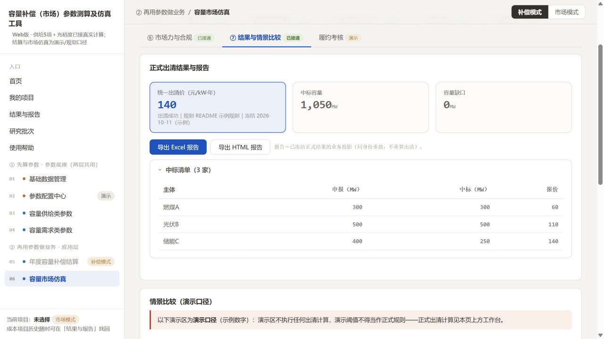
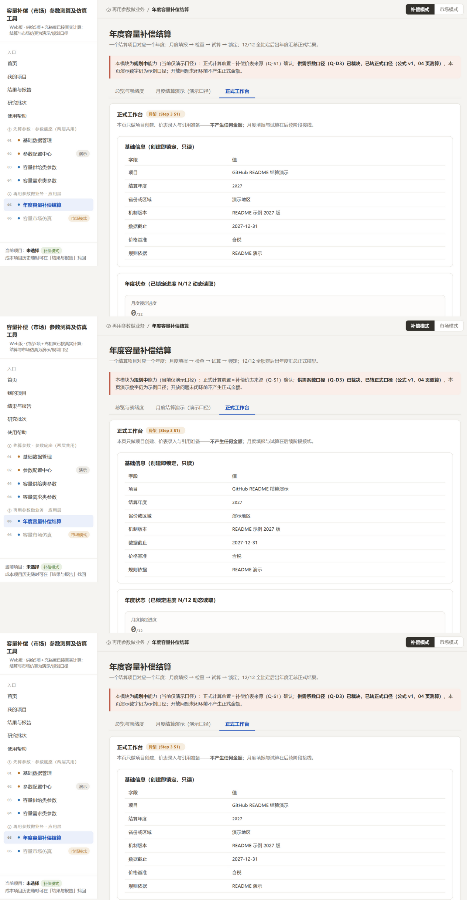

# ELCC 容量信用工具

本机运行的容量信用与容量市场分析工具：输入数据、选择充裕度/ELCC/EFC、查看真实计算进展，取得结果与分析报告。

**功能范围（四大模块）**

- **容量供给类参数**：成本三方法（固定成本／Gross CONE／Net CONE）；ELCC/EFC 六步测算模块（含基准标定、季节缩放、气象年权重）；充裕度评估（LOLE/LOLH/EUE/NEUE 四指标＋风险事件与缺供持续时间）。
- **容量需求类参数**：目标可靠容量（调整完美容量／调整负荷双口径）；容量缺口与备用裕度试算（含分资源构成分解）；容量供需系数（可冻结进结算）。
- **年度容量补偿结算**：年度项目→补偿价表（分类补偿）→主体台账→引用上游结果→月度四步（填报/检查/试算/锁定）→调整追溯→年度汇总发布→Excel/HTML 报告导出；支持 CSV 批量导入。
- **容量市场仿真**：七步工作台——VRR 需求曲线（锚＝目标可靠容量×Net CONE）→供给报价（申报不超核定）→统一出清→市场力画像与缓解对比→冻结正式结果→报告；PJM 容量市场规则参照。

**工程特点**

- 同一工具同一事实源：结果索引五通道（可靠性/成本/结算/市场/系数）＋报告与生成时的结果绑定（同身份重放、清单哈希校验）；
- 诚实终态：不收敛只报区间不报点值；缺额度如实披露；缺失数据不补零；
- 纯本地运行（127.0.0.1，不上传任何数据）；SQLite/文件系统存储，审计血缘随结果携带。

## 安装与运行（Windows，Python 3.12）

```powershell
python -m venv .venv
.venv\Scripts\pip install -e ".[report]"
.venv\Scripts\python -m capacity_credit.cli serve --workspace "<你的工作区路径>" --port 8633
# 浏览器打开 http://127.0.0.1:8633
```

按锁定文件精确复现环境：`pip install -r requirements\locks\...`（见 requirements/README.md）。

命令行批量入口：`python -m capacity_credit.cli --help`（project import / validate / scenario build 等）。

## 截图




## 边界声明（如实披露）

- 储能资源作 ELCC/EFC 候选处于 **experimental/provisional** 范围，不作为正式发布口径；
- P5 方法验证门已通过（正式重跑与 8 月基线逐位一致、金标回归通过）；P6 产品级验收尚未完成——本工具定位为**方法验证过的研究/内部使用工具**，不是面向外部用户的正式发布产品；
- 教学示范数据出数不代表真实省级结论。

## License

MIT（见 LICENSE）。
